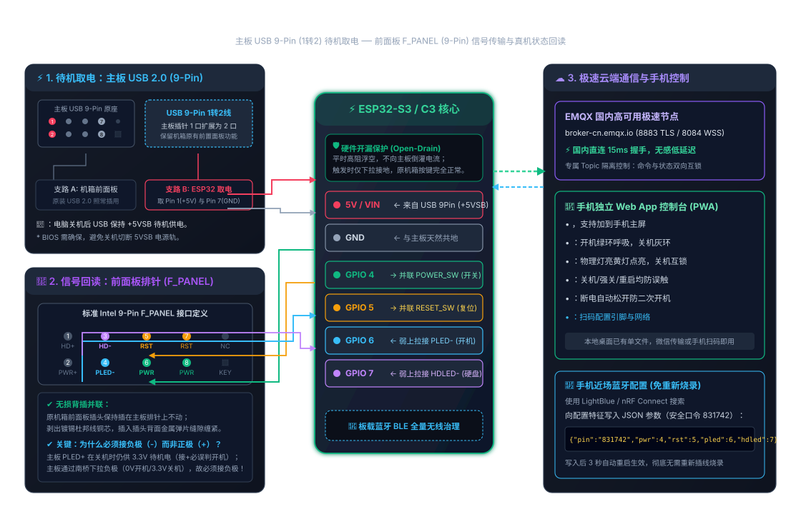

# pc_pwrbtn — ESP32-S3 电脑远程开关机 / 硬件级状态回读控制系统

基于 ESP32-S3 的机箱前面板（Front Panel）无损并联远程电脑控制系统。通过 **MQTT（TLS 加密）** 实现跨公网/外网移动端秒级远程开关机与硬重启，并通过前面板指示灯回读电脑真实的运行与硬盘活动状态。同时配备 **BLE 蓝牙无线治理** 与 **iOS/Android 深色玻璃拟态 Web App**。

<p align="center">
  
</p>

---

## 目录
- [功能特性](#功能特性)
- [安全警示与最安全操作规程](#-安全警示与最安全操作规程-mandatory-safety-sop)
- [硬件接线规范 (无损并联)](#硬件接线规范-无损并联)
- [固件编译与快速烧录](#固件编译与快速烧录)
- [控制通道与通信协议](#控制通道与通信协议)
  - [1. MQTT 远程控制协议](#1-mqtt-远程控制协议主通道)
  - [2. 蓝牙 BLE 无线全量治理](#2-蓝牙-ble-无线全量治理)
  - [3. 串口本地调试](#3-串口本地调试-115200)
- [PWA 移动端控制台 (Web App)](#pwa-移动端控制台-web-app)
- [常见问题排查](#常见问题排查-faq)
- [免责声明 (Disclaimer)](#-免责声明-disclaimer)

---

## 功能特性

| 核心能力 | 技术实现 | 业务价值 |
| :--- | :--- | :--- |
| **短按电源键** | GPIO 4 硬件开漏下拉 500ms | 远程触发开机 / 系统正常关机 |
| **长按强制断电** | GPIO 4 硬件开漏下拉 4500ms (自适应断电即松) | 电脑死机时物理断电，断电自动释放防二次开机 |
| **硬件复位** | GPIO 5 硬件开漏下拉 500ms | 远程硬重启电脑 |
| **真机开机状态回读** | GPIO 6 检测 PLED- 电平 (开机拉低 0V，pledInv=1 反相识别) | 精准区分开机/关机，解决待机 S5 供电误判开机痛点 |
| **硬盘读写状态镜像** | GPIO 7 检测 HDLED- 电平 (150ms 防抖电平镜像) | 实时 1:1 感知 NVMe 硬盘读写与空闲状态 |
| **原机箱物理按键保留** | 物理机械微动开关与开漏输出完全并联 | 机箱实体按键手感与原装指示灯完全正常使用 |
| **无线治理** | BLE GATT 服务，无需插线二次烧录 | 手机直接无线修改 WiFi、MQTT 与引脚极性 |

---

## ⚠️ 安全警示与最安全操作规程 (Mandatory Safety SOP)

进行任何硬件制作、拆装机箱与接线前，**请严格遵循以下最安全操作规程**：

### 1. 断电与防静电规范（绝不可带电接线）
* **拔掉机箱电源插头**：在触碰主板任何排针前，必须将主机电源（PSU）背后的机械翘板开关关闭，并**拔掉 220V 交流电源线**。
* **释放主板余电**：拔掉电源线后，反复按下机箱物理电源键 3~5 次，将主板滤波大电容中的残余电荷彻底放尽。
* **人体静电释放**：动手前用手触摸未涂漆的金属管道或机箱大面积金属外壳，释放人体携带的静电，防止击穿主板 CMOS 芯片。

### 2. 电气隔离与开漏安全（严禁高压倒灌）
* ESP32-S3 的 GPIO 工作电平为 **3.3V**（绝对最大耐受极限为 3.6V），**芯片不支持 5V/12V 电平输入！**
* **控制引脚（PWR_SW / RESET_SW）** 固件内部严格采用**开漏（Open-Drain）**模式工作：平时内部截止处于高阻浮空态，触发时仅下拉接地。**绝对禁止在任何代码中将控制引脚配置为推挽输出高电平**，否则会直接向主板开机上拉电路倒灌电流，造成主板南桥/IO芯片损毁。

### 3. 指示灯接线安全与低端控制原理
* 前面板电源指示灯（`PLED-`）与硬盘灯（`HDLED-`）必须在**原机箱面板 LED 依然插在排针上（回路保持闭合）**的前提下，从插头背面引出负极。
* **为什么接负极（Low-Side Switching）？**：现代 ATX 主板（如 Intel Z890 等平台）的 `PLED+` 和 `HDLED+` 常接在待机供电轨（+5VSB/+3.3VSB）上，即使关机依然常供 3.3V 电平；主板南桥是通过控制负极（`PLED-` / `HDLED-`）通断来实现灯光控制的：
  * **开机 / 点亮**：主板南桥内部 MOS 导通接地，将负极拉低到 **0V（低电平）**；
  * **关机 / 熄灭**：主板南桥断开接地，负极浮高至 **3.3V（高电平）**。
* **固件自动反相处理**：固件内置 `pledInv = 1`，引脚读取到 0V 准确识别为开机，读取到 3.3V 准确识别为关机，彻底解决误报问题。
* **为什么并联接线安全？**：由于机箱面板发光二极管（LED）本身具有固定导通压降，只要机箱灯正常插着，线路上测得的电压就会被钳位在 **2.5V~3.2V** 的安全电平，直接输入 ESP32 安全无虞。

### 4. 公共 MQTT Broker 凭据安全（防恶意入侵）
* 项目默认使用的 `broker.emqx.io:8883` 是免密公共 MQTT 服务器。
* **在公共服务器上，主题名（Topic）本身就是控制你电脑的唯一密码！**
* 任何人在外网只要获取了你的完整控制 Topic，即可向其发布指令关闭或重启你的计算机。
* **防护要求**：
  * 在部署到公开 GitHub 或向他人分享代码时，**绝对不能提交包含真实 Topic 和校园网密码的文件**。
  * 真实私密配置必须仅保存在被 `.gitignore` 排除的 `secrets.h` 本地文件中。
  * 实际使用时，请将 Topic 前缀设置得足够长且复杂（例如 `pcbtn/a9f8e71c4b260d`），防止被公网暴力扫描命中。

### 5. 强制断电（长按 6 秒）的数据损坏风险
* 长按电源键 6 秒是硬件级切断主板供电，等同于直接拔掉电源插头。
* 在 Windows 正在进行磁盘写入或系统更新时强制断电，可能造成文件系统损坏、未保存的数据完全丢失甚至系统引导损坏。
* **该功能仅限于电脑彻底死机蓝屏、远程桌面与网络均无法响应时的最终挽救手段**，切勿将其作为日常关机方式。

---

## 硬件接线规范 (无损并联)

### 0. 待机供电说明
* ESP32-S3 需要在电脑关机状态下依然保持通电。
* **最推荐取电口**：主板内部 **USB 2.0 9-Pin 插针**（通常关机后保持 +5VSB 供电）。
  * 取电接线：从插头背面并联插入，红线为 **+5V**（接开发板 5V/VIN 脚），黑线为 **GND**（接开发板 GND）。
  * 电脑主板 BIOS 需确保 **`ErP/EuP` 处于关闭（Disabled）状态**，否则关机后主板会切断待机 5V 供电。

### 1. 接线端口定义表
ESP32 与主板已由内部 USB 线天然共地，**每个按键与指示灯只需要引出一根信号线**：

| 功能 | ESP32-S3 引脚 | 前面板线束 (F_PANEL) 接线位置 | 模式 / 判定标准 | 说明 |
| :--- | :--- | :--- | :--- | :--- |
| **电源开关** | **GPIO 4** | 机箱前面板 `POWER SW` 任意一根 | 硬件开漏下拉 0.5s / 4.5s (自适应断电即松) | 平时高阻断开，不按键时不影响机箱物理开关 |
| **硬件复位** | **GPIO 5** | 机箱前面板 `RESET SW` 任意一根 | 硬件开漏下拉 0.5s | 平时高阻断开，按下模拟机箱复位键 |
| **电源灯 (开机回读)** | **GPIO 6** | 机箱前面板 `PLED-` (负极) | 输入 (内部弱上拉，反相判定 pledInv=1) | 开机主板拉低至 0V (识别为开机 1)，关机断开浮高至 3.3V (识别为关机 0) |
| **硬盘灯 (活动镜像)** | **GPIO 7** | 机箱前面板 `HDLED-` (负极) | 输入 (内部弱上拉，150ms 镜像限流) | 读写点亮主板拉低至 0V (镜像为 1)，空闲断开为 3.3V (镜像为 0) |

> **无损插入手法**：找到前面板两针插头（例如 `POWER SW`），将剪剥后的镀锡杜邦线铜芯紧贴插头背面的金属弹片缝隙轻轻插入到底，用绝缘胶布顺着原线束缠紧固定即可。原插头无需拔下，完全可逆。

---

## 固件编译与快速烧录

1. **环境准备**：
   - 安装 [Arduino IDE](https://www.arduino.cc/en/software)。
   - 在开发板管理器中安装 `esp32 by Espressif Systems`（推荐版本 >= 3.0.0）。
   - 在库管理器中安装 `PubSubClient by Nick O'Leary`。
2. **私有凭据配置**：
   - 复制目录下的 `secrets.example.h` 并重命名为 **`secrets.h`**。
   - 在 `secrets.h` 中填入你的 WiFi 账号密码（支持 802.1X 企业认证与普通 WPA2-PSK）、MQTT Broker 地址与专属控制 Topic。
   - `secrets.h` 已被 `.gitignore` 严密排除，绝不会被意外上传至 GitHub。
3. **烧录**：
   - 开发板选择：**`ESP32S3 Dev Module`**。
   - USB CDC On Boot 选择：**`Enabled`**。
   - 点击 **上传** 按钮，等待烧录完成。

---

## 控制通道与通信协议

### 1. MQTT 远程控制协议（主通道）

* **加密端口**：`broker.emqx.io:8883` (TLS)
* **下发控制主题**：`<Topic前缀>/set`
  * 发送 `press`：短按电源键 500ms（开机 / 正常关机）。
  * 发送 `force`：长按电源键 4500ms（强制断电关机，断电自动松开防二次开机）。
  * 发送 `reset`：按复位键 500ms（硬重启）。
  * 发送 `status`：立刻广播当前状态。
* **状态上报主题**：`<Topic前缀>/state` (Retained 模式，附带 LWT 掉线遗嘱)
  * 设备在线时广播全量 JSON 状态：
    ```json
    {
      "online": 1,
      "pc": 1,
      "pc_up": 4520,
      "disk_lit": 1,
      "disk_act": 1420,
      "disk_ago": 3,
      "rssi": -48,
      "ip": "10.20.236.80",
      "uptime": 300000,
      "last": "power_press"
    }
    ```
  * `pc`：`1` = 真机运行中，`0` = 已关机，`-1` = 未接侦测灯线。
  * `pc_up`：主机本次开机已持续的秒数（由单片机在检测到开机的瞬间开始计时，关机归零）。
  * `disk_lit`：硬盘指示灯当前电平镜像（`1` = 物理灯亮/读写中，`0` = 熄灭）。
  * `disk_act`：硬盘读写活动总脉冲计数。
  * `disk_ago`：距上一次读写活动过去的秒数。
  * `uptime`：ESP32 控制器自身的在线秒数。

### 2. 蓝牙 BLE 无线全量治理

当更换路由器、修改 WiFi 密码或需要调整引脚映射时，**无需重新连接电脑烧录代码**，直接使用手机蓝牙即可修改全量配置。

* **设备广播名称**：`pc_pwrbtn`
* **默认安全 PIN 码**：`831742`（可在 `secrets.h` 中自定义）
* **Service UUID**：`7a1e0001-9c3b-4f2a-8d5e-1b2c3d4e5f60`
* **配置特征 UUID**：`7a1e0002-9c3b-4f2a-8d5e-1b2c3d4e5f60` (可读可写)

#### 蓝牙修改操作步骤：
1. 手机打开应用商店下载 `nRF Connect`（Android）或 `LightBlue`（iOS）。
2. 扫描并连接名为 **`pc_pwrbtn`** 的蓝牙设备。
3. 展开 Service 找到 `0002` 配置特征，点击上传箭头（Write）。
4. 写入带有 `"pin"` 鉴权的 JSON 字符串，例如：
   ```json
   {"pin":"831742","ssid":"新WiFi名称","pass":"新WiFi密码","topic":"pcbtn/新控制前缀"}
   ```
5. 发送后 ESP32 将自动将新配置固化至 NVS 硬盘区，并在 2.5 秒后自动重启连入新网络。

### 3. 串口本地调试 (115200)
连接 USB 串口，键盘输入单字符可直接本地触发硬件测试：
* `p`：测试短按电源键
* `f`：测试长按强关
* `r`：测试复位
* `s`：输出当前 JSON 状态快照

---

## PWA 移动端控制台 (Web App)

项目自带专为移动端定制的深色玻璃拟态控制台（`index.html`）：

* **即开即用**：零外部依赖，使用纯前端 WSS（WebSocket Secure 8084）直连 MQTT，手机 4G/5G 均可随时秒级响应。
* **原生沉浸体验**：支持 iOS Safari 与 Android Chrome **“添加到主屏幕”**，自动隐藏浏览器地址栏与底部标签栏，表现与原生 App 完全一致。
* **状态与安全防护**：
  * 中央光环翡翠绿脉冲动态呈现电脑运行状态。
  * 右上角琥珀金指示灯伴随 硬盘 读写实时跳动脉冲。
  * 强制断电按键集成原生模态确认弹窗，杜绝任何日常误触。

---

## 常见问题排查 (FAQ)

1. **关机后 ESP32 也跟着断电？**
   - **排查**：进入主板 BIOS，找到 `Power Management` / `APM`，确保 **`ErP/EuP` 设置为 Disabled**；同时开启 `USB Power in S5`（关机保持 USB 供电）。
2. **手机发送指令后 ESP32 无反应？**
   - **排查**：检查 ESP32 串口日志，确认是否成功获取校园网/家庭 WiFi 的 IP 地址；确认手机与 ESP32 使用的主题前缀完全一致。
3. **开机状态显示与实际相反？**
   - **排查**：部分主板指示灯采用反向逻辑设计。通过蓝牙写入 `{"pin":"831742","inv":1}` 即可一键翻转判定极性，无需调换接线。

---

## 📄 免责声明 (Disclaimer)

1. 本项目属于硬件 DIY 实践指南与开源软件分享。使用者在组装、接线、调试和使用过程中，应当具备基础的电子电气常识与计算机硬件装配技能。
2. 本项目的作者与贡献者**不对任何因不当操作引起的直接或间接损失承担任何责任**，包括但不限于：
   - 因带电接线、引脚短路、过压接入导致的主板、电源、显卡或 ESP32 硬件损坏；
   - 因触发长按强制关机（Hold 6s）或硬重启导致的操作系统崩溃、文件系统损坏或重要数据丢失；
   - 因使用公共免密 MQTT Broker 且未妥善保护 Topic 前缀，导致设备遭受未授权第三方扫描与恶意控制。
3. 遵循本指南即代表使用者已充分理解相关操作的潜在风险，并自愿承担全部技术与安全责任。
